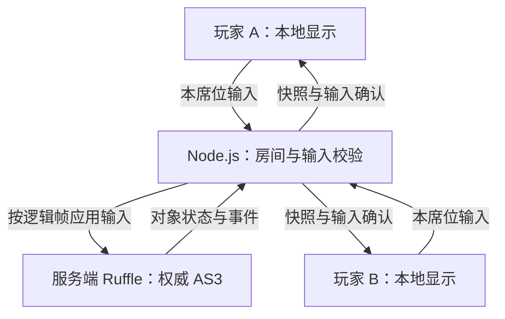

# 架构决策：自建服务器上的非视频双人联机

日期：2026-11-17。状态：**候选方案及验证计划，尚未完成两款原游戏接入验收。**

## 1. 决策与依据

优先验证 **服务端运行一份权威游戏，客户端接收结构化状态并本地显示**。在当前两款 AS3 游戏上，保留原玩法代码的候选实现是服务端 Chromium 中的 Ruffle/AS3，加上客户端 Ruffle 显示适配器。房间、席位、匹配与输入校验由 Node.js/WebSocket 服务负责。

这个选择服从三个已明确的约束：自行搭建服务器、不传游戏画面、允许对源码做一定修改。游戏文件和静态资源仍部署在自己的服务器；浏览器需要下载用于本地显示的 SWF/资源。权威游戏规则由服务器执行。

选择依据是本次实际源码：两款游戏都包含物理、随机、时间轴与显示对象依赖。只广播键盘事件不足以证明状态一致；要求所有客户端完全相同地重放旧 Flash 游戏，存在额外验证成本。单一权威实例可以避免把客户端物理确定性作为最初的必要条件，但代价是必须编写完整的状态导出和显示应用适配器，且服务端承担每房间运行成本。具体源码证据见 [冰火人审计](FIREBOY_SOURCE_AUDIT.md) 和 [闪翼审计](SHANYI_SOURCE_AUDIT.md)。

这不是“给任意 SWF 加几个网络回调即可联机”的承诺。**输入桥容易找到，完整对象状态与客户端显示分离才是关键工作。** 如果原运行时兼容性或状态分离成本不能接受，再转向完整 HTML5 源码接入或分阶段 TypeScript 移植。

## 2. 候选数据路径

房间创建后，权威实例载入指定构建和关卡。客户端只发送自己席位的动作、按键状态/边沿和可选指针。服务器分配逻辑帧并推进规则，生成场景快照和事件。客户端将对象位置、可见性、动作、动画阶段、机关状态等应用到本地资源。

客户端可在以后加入插值来平滑显示；原游戏预测和回滚需要另行验证。当前自写夹具直接应用更新的快照，没有声称完成原角色物理预测或解决高延迟下的操作手感。

### 当前仓库具体实现

当前宿主使用一个 Chromium 浏览器进程，每个房间创建独立 BrowserContext、页面和 Ruffle 实例。`server/ruffle-authority.mjs` 负责启动、桥接与快照校验；`server/index.mjs` 负责房间和传输。客户端从自建服务下载 Ruffle 和自写 `probe.swf`。

自写 AS3 的四个桥接接口是：

| 接口 | 当前夹具用途 | 原游戏适配时还需完成 |
| --- | --- | --- |
| `netHello` | 版本、协议、角色、步频握手 | 增加游戏/关卡/资产构建标识与能力声明 |
| `netStep` | 仅权威模式推进两个方块 | 接管实际玩法更新和所有影响结果的时序 |
| `netReadState` | 读取夹具完整快照 | 导出稳定对象 ID、机关、事件、动画和关卡状态 |
| `netApplyState` | 仅显示模式应用更新快照 | 停止客户端玩法副作用，可靠更新完整显示场景 |

Ruffle 的公开 [`PlayerV1` API](https://ruffle.rs/js-docs/master/interfaces/Player.PlayerV1.html) 提供 `callExternalInterface`，用于调用 SWF 已注册的 AS3 回调。这个公开接口没有提供通用的整部游戏快照/恢复或逐逻辑帧执行方法；本仓库中的 `netStep` 等接口属于自写 AS3 夹具。原游戏需要专门实现同等能力。公开 API 的 `suspend/resume` 会停止/恢复影片执行，也不能直接当作通用物理步进接口。

夹具配置的 25 次/秒是该实验的调度目标，不代表两款原游戏都应使用相同步频，更不是已测得的运行性能。

## 3. 为什么先验证这条路线

| 路线 | 有利条件 | 当前材料下的主要成本 | 此阶段决定 |
| --- | --- | --- | --- |
| 服务端 AS3 权威、客户端显示 | 保留原规则的机会较大；客户端无需重算完全一致的物理；集中判定胜负 | 原 SWF 兼容性、受控更新、完整状态导出、显示适配和服务端运行成本 | **优先做小范围验证**，通过后再扩大 |
| 确定性锁步，主要同步输入 | 模拟已能确定性重放；对带宽较敏感；可以控制所有时间和随机来源 | 原游戏的多处 ENTER_FRAME、动画判定、随机、外部时间与旧物理引擎都要纳入验证；慢客户端/迟到输入可能拖住进度 | 不作为当前默认方案；仅在确定性证据充分后评估 |
| 回滚同步 | 低延迟操作要求高，且有完整快速的保存/恢复和重模拟 | 两款原游戏尚无完整状态快照；Box2D 接触/关节、动画、对象生成/销毁和声音副作用复杂 | 后续专题，不以“同步坐标”冒充回滚 |
| TypeScript/原生 Web 重写 | 能投入迁移，长期希望纯逻辑服务端和清晰的表现层 | 需重做物理、机关、关卡结果与动作时序，并对原版回归；当前数据提取不能替代这些实现 | 原运行时路线不可控时采用渐进移植 |
| 接入已有完整 HTML5 实现 | 有可运行、可修改且允许使用的完整源码、资源和依赖 | 当前附件只有关卡 JSON，缺运行 JS 与 tileset 元数据；来源和版本还需核实 | 补齐材料后重新比较，可能降低长期成本 |
| C++ 重制再转 WebAssembly | 重制功能已经符合产品需求，工程和资源完整 | 当前为另一套实现，缺构建清单和 Resources；仍需浏览器移植与网络适配 | 不作为原版已经可复用的证据 |

锁步要求同初始状态、同输入和同帧产生相同结果，且缺少该帧输入时需要等待。相关原理见 Glenn Fiedler 的 [Deterministic Lockstep](https://gafferongames.com/post/deterministic_lockstep/)。这里并未据此断言 Ruffle 必然不确定；结论是两款具体原包还没有完成确定性验证，不能提前依赖这个性质。

平台的匹配、房间、席位和消息校验应与游戏适配器分开。将来某款游戏改用 TypeScript 权威逻辑，不应重写整个大厅；但“统一协议”也不意味着所有游戏能共享同一套状态导出器。

## 4. 冰火人：最小切入点与真实改造量

优先目标是第一代单关。以下路径相对于 `02-fireboy-watergirl/decompiled/1-export/script/scripts/`，完整出处见 [专项审计](FIREBOY_SOURCE_AUDIT.md)。

| 部位 | 原始接口/行为 | 最小适配方向 |
| --- | --- | --- |
| 初始化 | `Game.StartGame` 创建 `level(mode, number)` | 将关卡选择变成服务器认可的房间命令，并校验版本 |
| 输入 | `Game.keyPressed/keyReleased` 写六个布尔量 | 由服务器席位分别写火/水三方向状态；保留跳跃松开锁存 |
| 时钟 | 舞台声明 25 FPS；Box2D 每步 1/26、迭代 50 | 分别保留舞台/逻辑调度与物理积分，明确帧顺序 |
| 玩法更新 | `level.Update` 混合物理、机关、显示、死亡/通关 | 权威模式执行规则，显示模式禁止独立碰撞、收集或胜负判定 |
| 导出 | 原代码没有完整联网快照 | 建立角色、箱子、机关、钻石、门、动画状态与事件 ID |
| 计时/存档 | `getTimer()`、SharedObject | 定义房间时间与存档职责，避免浏览器本地存档改变同局状态 |

已安全提取的 32 关可作为移植输入；地形包括三角碰撞块和同时含传感器/实体边缘的池子，机关还包括滑动/旋转/悬挂平台、滑轮、按钮、杠杆和风。不能将所有非零瓦片映射成普通墙。

其中 `adventure-5` 的瓦片 `4` 保留为 unsupported。`CreateFinish` 的参数也不是最终 body 中心，原工厂会额外调整坐标。运行器必须遵守这些来源信息。

通关依赖门 MovieClip 到达第 22 帧，因此客户端“只设人物坐标、继续让门动画自己跑”仍可能出现不同的结果。权威端应输出通关状态和需要一致的动画阶段；客户端可以本地补间纯装饰效果，但不得据本地动画重新判定胜负。

当前缺少 `assets.swf`、原 SWF 及其他资源；第一代源码还有发行站点 URL 绑定。先建立合法可运行的原包基准，再判断输入和显示适配实际要改多少处。文本较完整并不能代替运行包。

## 5. 闪翼双星：需先过运行兼容性关

优先讨论正传的两个独立角色；续作两套按键可能映射同一个角色，不能拿续作替代双人正传验收。依据见 [专项审计](SHANYI_SOURCE_AUDIT.md)。

| 部位 | 已定位事实 | 最小适配方向与限制 |
| --- | --- | --- |
| 输入 | `misc/Input.as` 管理 kd/kp/ku；FireManHero 用 WASD，IceManHero 用方向键 | 桥接持续按住、按下与松开边沿，按逻辑帧清理；覆盖梯子、船和其他角色分支 |
| 物理 | WCK/Box2DAS 使用 Alchemy 库，ENTER_FRAME 推进世界 | 先确认原 SWF 中相关运行时在选定 Ruffle 版本下可用 |
| 慢动作 | `boom()` 切换物理步长到 0.02、舞台到 15 FPS，之后恢复 0.05/30 | 把慢动作模式和按帧恢复计数纳入权威时序 |
| 碰撞/动作 | 显示列表 `hitTestObject`、MovieClip.currentFrame 参与动作和判定 | 资源时间轴和显示实例是规则依赖，不能完全用简单物理 body 代替 |
| 动态世界 | 敌人随机决策、角色形态、机关和对象增删 | 为网络快照定义对象生命周期、动作阶段及事件去重 |
| 构建 | 正传大量 AS3 含 `§§push/§§pop` 等反编译伪表示 | 不能直接把反编译目录当正常 AS3 工程；需原工程或基于完整 SWF 的可复现修改链路 |

30 FPS 是源码的恢复值，本次没有缺失 SWF 的包头来确认初始帧率。任何适配都应以实际原包基准补齐这一点。

如果需要保留显示列表参与碰撞，服务端的“无画面传输”不等于“没有显示对象运行成本”。Ruffle 仍须维护原运行对象；是否能减少渲染工作又不改变规则，需要实际测量和验证，不能预先承诺轻量服务器高并发。

## 6. 输入、快照与恢复的约定

详细输入模型见 [输入与时钟契约](INPUT_AND_CLOCK_CONTRACT.md)。平台只接受固定游戏构建的动作消息，席位由服务端连接关系决定；客户端不能提交角色位置或声明自己控制另一个玩家。

动作包含持续状态和必要的边沿。服务器保留两次 tick 之间的短按，忽略重复/旧输入，失焦、断线及输入超时释放操作。指针按玩家分开记录并采用明确坐标系；菜单、选关、重试和暂停应成为房间命令。

当前夹具用每帧按下/松开位图保存“该类边沿是否出现过”。它不保存同一个 tick 内同一按钮任意多次点击的次数；原游戏如依赖双击或完整点击顺序，应增加带编号的事件队列，不能从夹具通过推断该语义已覆盖。

原游戏至少需要两种不同用途的状态，不能混用：

| 状态用途 | 应包含什么 | 能做什么 |
| --- | --- | --- |
| 客户端显示快照 | tick、对象 ID/类型、变换、可见性、动作/动画阶段、机关、收集状态、阶段结果及事件游标 | 同步画面中的世界、晚加入和浏览器重连 |
| 权威恢复检查点 | 上述内容，以及物理世界内部状态、接触/关节、随机状态、定时器、输入锁存和逻辑对象引用关系 | 才可能支持权威迁移、崩溃恢复或回滚 |

当前夹具结构简单，其快照已经覆盖该夹具状态；这不能证明复杂 Flash 世界也可由同样几个字段恢复。当前房间重连仅是连接回到仍存活的权威实例，不等于 Node 或浏览器进程重启后能恢复对局。

传输先用 WebSocket，便于自建部署和调试。可靠有序通道仍可能受排队和队头阻塞影响，所以状态发送要处理背压和过期快照。需要切换 WebRTC DataChannel 等传输时，应先测出具体问题；更换传输不会自动解决不完整状态或时钟漂移。

## 7. 测量与验收计划

当前仅能据已生成文件确认源码审计、关卡提取和自写 AS3 编译。浏览器验证受本地环境阻塞，后续以正常服务器或 CI 产出的 `evidence/*.json` 为准。没有本地浏览器成功记录，也没有公网性能数字。

| 阶段 | 验收内容 | 通过后可以得出的结论 |
| --- | --- | --- |
| A：材料与构建 | 文件清单、哈希、原创夹具编译、提取器测试 | 工具和材料可追溯；不代表原游戏可运行 |
| B：独立网络/AS3 夹具 | 真正启动服务端 AS3 与两个客户端；独立操作、快照一致、非法输入拒绝、短按、失焦、重连和配对 | 当前夹具和协议在记录环境中成立 |
| C：原包基准 | 未修改原 SWF 加载、双人动作、典型机关、死亡和通关 | 指定游戏构建在指定运行时可用 |
| D：单关适配 | 原游戏输入接入、完整场景状态导出/应用、客户端禁止规则副作用 | 该关卡已完成原版联机的垂直验证 |
| E：玩法覆盖 | 每种机关、形态、随机敌人、暂停/慢动作、胜负与资源生命周期 | 覆盖范围内行为可接受，再逐步开放更多关卡 |
| F：实际部署 | 两台异地设备、延迟/抖动条件、多房间 CPU/内存、故障与资源释放 | 仅对所测机器、版本、场景和网络条件形成容量/手感结论 |

性能先测每房间权威 step 的分布、超时或漏掉调度槽次数、状态体积、每客户端发送频率、Node 与浏览器的总资源、创建/销毁成本，以及端到端输入到显示延迟。当前服务中的 Node RSS 并不包括整个 Chromium 进程树，不能据此宣称完整每房间内存占用。

估算状态传输可从“单次状态字节数 × 广播频率 × 接收玩家数”开始；正式容量结论还需加入协议开销、初始资源、房间管理、峰值与余量。任何公式都不是实测数据。应用层延迟/消息丢弃实验也应明确其层级，不称作真实 WAN 压测。

## 8. 后续工程顺序

先让阶段 B 在正常 Linux/CI 环境产生可审查证据，同时补齐两款原包。随后只选冰火人第一代的一关完成 C/D，以此评估状态适配工作量和服务端成本。若结果可接受，再扩展机关覆盖和房间规模；若 Ruffle 兼容性或状态分离成本成为主要障碍，则用已提取的内容和原版基准启动原生 Web 移植。

平台产品化再补账号与房间权限、邀请与匹配策略、进程隔离和资源配额、版本发布、观战、存档及运维监控。单进程实验的 MAX_ROOMS 配置、短期席位保留和浏览器 Context 隔离不能直接等同于这些完整能力。

### 参考材料

- [Ruffle PlayerV1 官方 API](https://ruffle.rs/js-docs/master/interfaces/Player.PlayerV1.html)：ExternalInterface 桥接与影片暂停接口。
- [Playwright 官方浏览器安装说明](https://playwright.dev/docs/browsers)：浏览器版本、系统依赖与 headless shell。
- [Glenn Fiedler：Deterministic Lockstep](https://gafferongames.com/post/deterministic_lockstep/)：输入锁步的前提与等待输入的行为。
- 本仓库两份源码审计及输入/时钟契约：本次方案中有关两款具体游戏的判断依据。

外部文档以本次查阅内容为准；实际依赖版本由 `package-lock.json` 锁定，不能以在线 master 文档代替锁定版本的运行测试。
