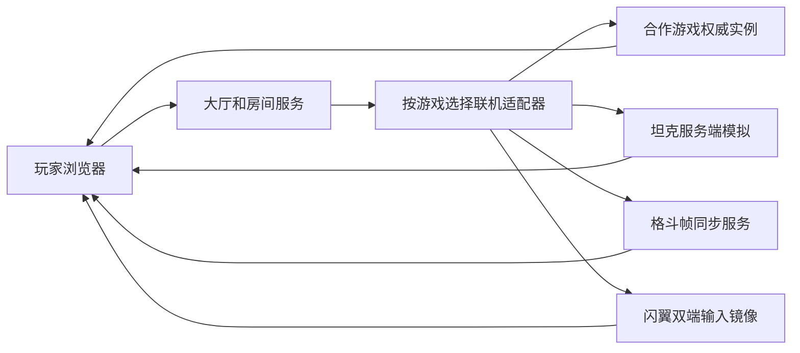

# 肥鱼乐园联机工程总结

记录于 2026 年 11 月 25 日。本文面向接手开发和维护的人，记录已运行的联机架构、选型依据、故障修复和验收方法。文中的源码路径对应部署维护工作区。GitHub 研究分支保留早期实验基线，阅读时可用本文区分研究结果、后续部署实现和仍待验证的范围。

## 1. 整体架构

用户从按游戏组织的大厅创建房间，或用房名、邀请链接和房间密码加入。大厅负责游戏目录、房间查询、席位、开局与返回流程。各游戏使用自己的同步适配器，房间之间分别维护操作流和生命周期。玩家端在本地绘制，通常交换输入、逻辑帧或结构化快照。《死神 vs 火影》的只读观战另有独立捕获链路。

- `scripts/start-game-lobby.mjs` 是多游戏大厅入口。`npm start` 指向早期原创 AS3 探针，可继续用于传输与桥接回归。参见 [架构决策](ARCHITECTURE_DECISION.md) 和 [原始验证报告](VERIFICATION_REPORT.md)。
- `config/games/`、`server/game-adapter.mjs`、`server/game-catalog.mjs` 描述并发现游戏包、运行时与能力。自带权威服务的游戏可以通过外部适配器接入。先检查可运行入口、私有依赖、输入钩子与同步边界，再决定是否进入大厅。
- `server/room-lobby.mjs` 按房间管理会话，`server/room-registry.mjs` 管理房名、密码及存档。持久房间使用规范化后的名称作为查重键，保存加盐密码摘要，串行写临时文件后替换数据文件。Glorton 有独立的短期房间登记，通过大厅接口合并展示，创建时检查共享房名空间。标准大厅与游戏内部房间应有显式映射，玩家用同一个房名完成查询、邀请与加入。

## 2. 各游戏的联机选型

| 游戏或实验 | 同步方式 | 适用条件与边界 |
| --- | --- | --- |
| 森林冰火人等合作关卡 | 一个 Chromium 实例运行原 Phaser/Box2D 权威逻辑。玩家浏览器投影结构化对象快照，使用本地游戏资源绘制 | 适用于场景和物理较难跨浏览器确定性重放的游戏。可核对的固定研究候选实验覆盖钻石、按钮、平台和箱子等机制。结论按具体版本与关卡记录 |
| 闪翼双星 | 每端运行自己的 Ruffle/SWF，镜像席位键鼠、在线与暂停状态，约 30 Hz 交换英雄位置和速度用于纠偏 | 实验性输入镜像。机关、随机数或时钟累积差异仍可能让两端分叉。适配器是 `server/shanyi-mirror-room.mjs` 和 `adapters/shanyi-flash/` |
| 死神 vs 火影 3.3 | 两个浏览器运行固定版本的游戏，服务转发顺序一致的输入帧，逐帧进行一致性检查 | 复用私有浏览器构建与格斗服务。大厅适配器处理开局席位、邀请和观战。通用 `/lockstep` 30 Hz 夹具与实际 3.3 对战是两套验收对象 |
| 迷宫坦克 | 服务端统一模拟移动、命中、道具、物理和计分，浏览器接收快照并插值绘制 | 2–6 人。适合自行掌控规则与回合状态的原创游戏。运行中入场按模式决定立即复活或等待下一小局 |
| 疯狂小人乱斗 | Python 权威服务以 40 Hz 发布已确认输入和校验摘要。浏览器中的 Pygame/WASM 执行同一引擎并本地绘制 | 2–4 真人席位。快照用于重连和校正。主路径使用 HTTP 与 WebSocket，依赖发行方的浏览器资源和固定引擎版本 |
| 云台乱斗 | 原创服务端模拟，向浏览器发送约 25 Hz 的权威状态并插值 | 作为 2–6 人服务器权威与触屏输入的工程实例保留。已从新建游戏目录下架，已有兼容房间仍可用邀请进入 |

### 合作关卡的状态投影

权威实例只向已绑定席位消费对应角色的操作。客户端冻结自己的游戏物理，并把权威状态映射到显示对象。快照需要稳定的实体 ID、消失标记和场景代次。已经拾取的钻石、已经改变的机关和当前箱子位置都属于新加入玩家的初始状态。只在初始化时扫描对象会遗漏跨关与动态新增对象。

进入重开或换关时，停止向旧场景注入输入，更新场景代次，再等新场景就绪、重绑对象并发布完整状态。死亡重开和通关后的下一关确认是不同生命周期事件，前者恢复当前关，后者记录当前关完成并经玩家确认。固定研究构建的验收方法见 [状态投影进展](HTML5_VISUAL_SYNC_STATUS.md)、[推箱子实测](HTML5_BOX_PUSH.md) 和 [晚加入修复](HTML5_REJOIN_FIX.md)。

### 死神 vs 火影的帧同步与观战

私有适配基于固定的 3.3 浏览器构建。复用同源 `/bvn33/` 提供入口、资源和对战连接，保留兼容入口供旧链接使用。`scripts/bvn33-frame-window.mjs` 按玩家的 WebSocket 控制帧 RTT 和抖动调节待确认帧窗口，接收确认后再推进窗口。`server/bvn33-room-service.mjs` 负责大厅和格斗服务之间的席位及房间协调。

观战只在真实对局进行中开放。观众凭房间密码进入独立只读链路，捕获服务只输出低帧率、无声画面。玩家退出或房间关闭时，观战端也退出并收到提示。观战成本和玩家输入延迟应分开测量。

浏览器缓存适用于固定版本的游戏资源。入口、凭据和实时 API 按短生命周期处理，资源 URL 随内容版本变化。测试应分别覆盖首次进入、正常刷新和另开标签页，检查关键资源是否重复下载。实际对战和通用夹具的验证边界记录在维护工作区的 `docs/BVN_LOCKSTEP.md`。

### 迷宫坦克的权威模拟

`server/tank-arena-sim.mjs` 以固定规则步推进战斗，`server/tank-arena-match.mjs` 管理网络、对局与计分。当前实现以 60 Hz 更新，单次追赶最多消化约五步积压。比赛中通常以约 30 Hz 发送快照，空闲期约 10 Hz。慢连接积压时跳过过期快照，恢复后可拿到更新的状态。客户端用上一份和最新一份快照插值，绘制循环与服务端步长各自运行。

- 地图种子和参赛人数决定地图布局。命中、护甲、反弹、道具、计分和复活都由同一模拟裁决。激光预瞄与命中共用反射计算，避免提示路径和实际物理分离。
- 同房间可投票切换模式。击毁归属与总分分别记录，自毁只增加死亡。决胜后的过场仍允许正常操作和产生击毁记录，胜负锁定后由同一房间自动续局。
- 中途加入、离开、刷新和结束都按席位处理。复活模式可从安全出生点进场，按小局淘汰的模式把新人排到下一局。掉线保留窗口当前为 45 秒。
- 实测同时检查正常对局、跨房隔离、反弹规则、重复开局和慢连接。实际输入手感还受浏览器帧间抖动影响，应和协议指标分开记录。

### 疯狂小人乱斗的确认帧与多轮生命周期

在 `scripts/glorton-multiplayer-authority.py` 中扩展固定版 Python 权威引擎。`server/glorton-browser-rooms.mjs` 负责准入和浏览器席位。`server/glorton-sync-tunnel.mjs` 将浏览器同源 `/glorton-online/browser-ws` 转到回环权威服务。网页的 `public/glorton-online/local-session.mjs` 和 `adapters/glorton-browser/sync_client.py` 把确认帧送进 Pygame/WASM。

- 加入请求先发候选凭据，浏览器完成加载并连上后才占正式席位。失败或离开时及时释放。显示房名、旧房间码和邀请链接解析到同一房间，刷新沿用自己的席位。密码校验、席位凭据、临时关闭和显示名称各有独立用途。
- 发送变化后的持续按键与短按边沿，由权威保持持续状态。浏览器在模拟循环中直接消费 WebSocket 收件箱。相同逻辑帧的控制位掩码按席位排列，协商后使用紧凑文本帧，继续保留 tick、输入确认号和摘要。典型四席测试帧从约 772 字节降到约 90 字节。
- 依据已应用帧确认和 RTT 控制待确认窗口。一个浏览器暂停渲染时限制它的积压，必要时用权威快照跳至当前逻辑帧。快照转发保留 Python 数字字面量，例如 `-0.0`。恢复状态覆盖随机与模拟延续所需的字段，包括倒计时累积量及镜头目标索引。视觉插值和本地细微预测隔离于校验状态。
- 房间有准备、开战、结算与回到选角的明确阶段。准备状态按席位变更。每席一张地图票，最高票直接选中，并列第一时由服务器随机抽一张并同步给全员。无人投票时用配置的默认地图。结算后全员确认再战，仍用原房与席位，重新选图和准备。`round` 隔离旧局的帧、确认、投票和快照，初始化时核对规则值已落到权威状态。一命配置曾仅写进开局描述，真实角色仍有五命，通过初始快照检查定位并修复。
- 加载包只含本项目浏览器适配代码。发行方引擎与素材由浏览器按固定来源加载或通过私有构建提供。公网验收验证了入口、联机投票和双人操作。隔离环境另外验证了四席刷新恢复，以及真实权威对局中的自然结算与第二局启动。有双浏览器复测曾卡在 P2 外部素材加载，记录时应注明覆盖范围。

## 3. 房间、输入与界面的共通约定

| 场景 | 工程约定 |
| --- | --- |
| 创建房间和跨房隔离 | 匹配使用稳定房间键。对局进程或模拟按房分配，清理当前房间时同时回收本房连接和权威资源。房名、密码和存档均按所属房间管理 |
| 重入和离开 | 短断线进入可恢复状态，显式退出立即释放。过期的座位和失效的对局有明确提示。加载阶段有超时，可重试或返回大厅 |
| 计时与存档 | 合作关卡保存进度。大厅中的空置对战房在席位释放后计时，达到配置的回收时间才清除。Glorton 的浏览器房间采用各自的短期生命周期 |
| 输入归属 | 服务端以凭据绑定席位，并检查顺序号、角色归属及当前阶段。按下和松开都可能发生在同一逻辑帧之间，短按用边沿保留。失焦或断线需清理持续输入 |
| 开局、换场和再战 | 用服务器确认的状态产生动作。换关或新回合时重置相关状态，保留应继续使用的席位与设置。双方准备和全员再战各有独立含义 |
| 电脑与触屏 | 有触屏控制的适配器与键盘共用游戏输入协议。电脑显示键位与房间状态，触屏按钮按设备条件显示。窄屏应验证控件可见、布局可滚动、交互与游戏焦点互不抢占 |

保持各游戏 HUD 围绕公共信息组织，例如房名、在线状态、连接和可执行操作。观战、补位、票数、比分和重连按钮按游戏能力显示。大厅显示已缓存的最近一次成功读取数据，后台重试，短时失败时保留用户搜索与填表上下文。

准备按钮发送本席位的目标布尔值，等服务端确认后更新。自己的实际选角或投票变更可以取消本席位的准备。全局规则改变时可重新收集全员确认。统一房间广播顺序，避免较早的座位状态在较晚的准备状态之后抵达。网页侧由一套选角控件消费准备操作，游戏引擎只在战斗阶段消费对战按键。

## 4. 性能定位与实测经验

### 先对齐指标

| 指标 | 如何解释 |
| --- | --- |
| 网络往返 RTT | WebSocket 控制帧探测，主要反映连线及代理路径。比较不同游戏时使用同一设备、入口、采样期和口径 |
| 应用回包与输入确认 | 应用请求经过游戏服务的回包时间，以及按键发送到权威确认帧的时间。前者还反映浏览器事件循环、队列和上游工作量 |
| 同步积压 | 已收到的最新逻辑 tick 和已应用 tick 的差。与待发送字节、确认窗口及快照恢复次数一起定位单席卡顿 |
| 画面 FPS 与单帧绘制耗时 | 统计实际完成显示的帧，按照静止、镜头移动、特效密集、回合切换和窗口尺寸分别测量。模拟 Hz 与画面 FPS 独立 |

同一客户端走同一公网入口的对照中，死神 vs 火影与 Glorton 的控制帧 RTT 中位数均约 34 ms。Glorton 旧显示包含更多应用链路时间，两个 HUD 原数字有口径差异。修正后分别显示网络往返、可选的游戏回包及画面帧率。另一次公网双人实战测到 41–44 ms 控制帧往返、45–48 ms 输入发送到权威确认回包。重连复测曾出现约 500 ms 的应用回包尖峰，随后恢复同步。这些数字只描述对应测试条件。

### 移动镜头掉帧

Glorton 在静止时命中整屏地图缓存，大窗口移动时反复合成底图、前景和透明中间层。旧版静止场景接近 60 FPS，实际跑跳可跌到约 10 FPS。测试改为固定大画布，持续输入并检查地形像素确实移动，再采样呈现帧率。

- `adapters/glorton-browser/render_scene.py` 用 SDL2 直接合成静态地图，减少全屏中间层。具有独立动画的地图继续使用原图层缓存。
- `adapters/glorton-browser/stage_budget.py` 在地图持续超出预算时只降低地图层采样分辨率。角色与计分界面继续使用完整画布。画布随窗口和设备像素比调整，放大位图时避免反复平滑。
- 同一台测试机的 1234×733 双人移动场景从旧版中位数 10.6 FPS 提升到新版公网测试的 53.1 FPS，最低采样 48.5 FPS。另一次同分辨率候选测到 34.3 FPS。两组数字都保留，有利于评估机器负载和浏览器调度波动。
- 特效黑块曾由浏览器 SDL 对全透明索引色 PNG 的解码差异触发。适配器跳过完全透明的绘制帧，同时保留原动画时序。先区分缺失资源、缩放质量、透明度解码和着色环节再修图。

## 5. 部署、回退与故障排查

局域网和公网各运行一套大厅与房间库。首页实测局域网入口连通后启用对应按钮。公网的网页、实时大厅和可同源的游戏对局优先经过一个对外入口，特定适配器保留旧通道作为回退。回退时沿用当前房间和席位。专用权威进程可在本机回环监听，由大厅代理。FRP 映射对外所需通道，Windows 任务负责启动服务。FRP 控制连接、HTTP 健康检查和 WebSocket 对局各能单独失败，应按层排查。

发布先在隔离端口运行候选大厅与权威服务，保留上一版可启动配置，确认新版资源版本、HTTP、握手和真实对局能同时通过。只改静态客户端时，可在备份后原子替换启动包与入口。协议或权威切换时，先确认有哪些活跃对局，走空闲切换或经授权结束指定测试局。切换后使用浏览器实际访问的入口复测，健康检查失败时恢复上一版。

资源发布要同时验版本入口、包内容的哈希和实际握手。固定版本资源可以复用缓存，首屏与小型启动包应支持失败后重新请求。独立记录首装下载、带缓存刷新与 WebSocket 重连三种结果。公开入口访问应以实际浏览器条件复验，尤其是同源代理、内网探测和仅在第三方 CDN 失败时出现的半加载页面。

| 现象 | 排查顺序 |
| --- | --- |
| 大厅或游戏页间歇性 502 | 核对本机源服务、FRP 和对外入口。分别请求入口 HTML、JS/CSS、游戏启动包、健康接口及 WebSocket。记录失败发生在网关、服务启动、资源下载还是席位准入 |
| 刷新停在等待重连 | 核对房间是否仍允许恢复、席位凭据是否属于当前标签、旧 WebSocket 是否占位、房间和对局代次是否匹配。界面应在超时后恢复重试和退出入口 |
| 房间列表有空位却加入失败 | 分开看登记人数、实际已握手席位和待加载凭据。测试未完成初始化的访客、同时加入、显式退出以及换标签重进 |
| 对局中延迟越来越高 | 分别采样控制 RTT、应用回包、模拟积压和帧耗时。若积压只在一个席位增长，验证其他席位能继续和慢席位能通过快照追上 |
| 只在新一局才失步 | 核对场景或回合编号、输入确认号、时间累积、随机种子及初始规则字段。检查迟到的上一局帧和断线前的持续输入是否被清理 |

## 6. 复验和归档

- 协议测试验证短按边沿、权限、同房与跨房、快照恢复、旧回合丢弃、同票候选池及准备状态。实际浏览器测试从大厅建房和输入密码入手，检查两端真实按键、画面变化、胜负、刷新后仍能操作，以及再战后进入第二局。
- 多人验收覆盖游戏支持的实际席位数。强制暂停一个渲染器，确认其余玩家仍能收帧，再验证慢席位追上。性能场景包含持续移动镜头、大窗口和多浏览器，防止把静止测试数字当作实战水平。
- 在部署维护工作区，可使用 `npm test`、`scripts/verify-multiplayer-lobby.mjs`、`scripts/verify-lobby-resume.mjs`、`scripts/verify-bvn33.mjs`、`scripts/verify-bvn33-cache.mjs`、`scripts/verify-tank-trouble.mjs` 与 `scripts/verify-glorton-local.mjs`。Glorton 浏览器脚本可按任务启用 `GLORTON_VERIFY_REMATCH`、`GLORTON_VERIFY_MOVEMENT`、`GLORTON_VERIFY_STALL` 和 `GLORTON_VERIFY_PROVIDER`。`tests/test_glorton_authority.py` 依赖固定的私有运行时。
- 一次可查的验证记录至少包含构建版本、资源出处、设备和入口、场景、实际结果、失败点及清理结果。用回环证明功能，用局域网检查常规连通，用实际公网入口检查代理和对局。跨区域容量、长期稳定性、全关卡通关及各类移动端体验仍需各自验收。
- 仓库记录自写适配器、结构、验证和来源说明。第三方游戏原包、私有部署物料和访问凭据由授权环境管理。保留最小可复现的配置样例、文件校验和及本地依赖说明。版本区分和验证来源示例见 [HTML5 适配报告](HTML5_ADAPTATION_REPORT.md)。
