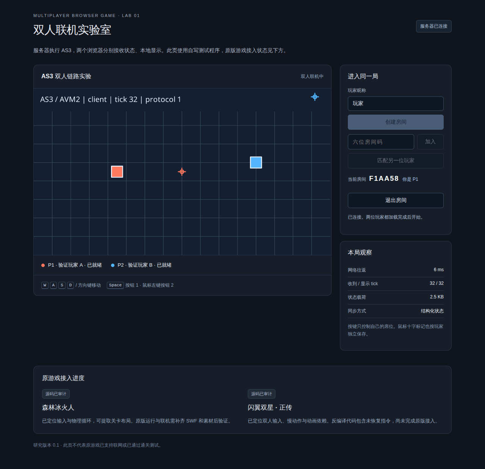
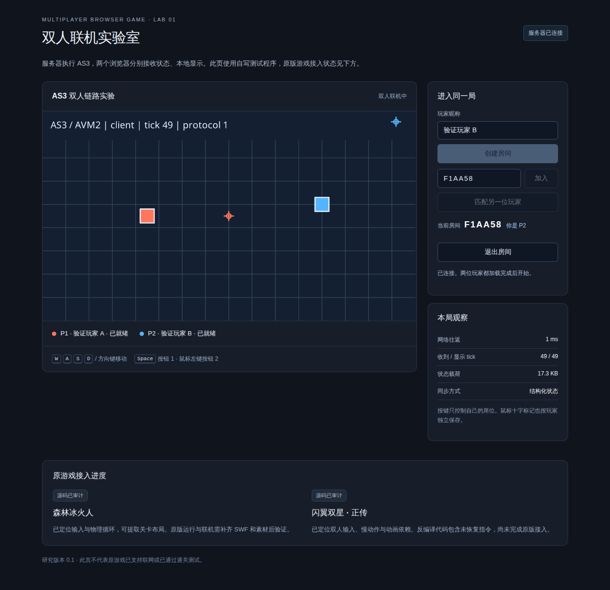

# 实际验证报告

日期：2026-11-17。结论：**自写 AS3/AVM2 联机探针的真实浏览器与网络实验已通过；两款原游戏尚未运行或完成联机适配。**

## 1. 可核查的运行来源

| 项目 | 记录 |
| --- | --- |
| 已测代码提交 | `b1779ed50d5d222a61b5e95d7388c1bec9425801` |
| CI | [GitHub Actions #3](https://github.com/scarlet20252025-cloud/multiplayer-browser-game/actions/runs/44033828759)，整体 `success` |
| 时间 | 2026-11-17，约北京时间 14:48 完成 |
| 环境 | Ubuntu 26.04.1、Node 24.22.2、Chrome Headless Shell 151.0.7922.34 |
| 锁定依赖 | Ruffle 0.7.1、Playwright 1.62.1、ws 8.23.0 |
| 图形 | 无界面 Chromium，使用 SwiftShader 软件渲染 |
| 测试包 | `verification-44033828759-1`，artifact ID `14305839568` |
| 下载校验 | artifact ZIP SHA-256 `9d25701f1c5db7d79331ce0b09bc4f0fe2d64cfa76056f932ad19b451c38537f`，下载后已核对 |

原始 JSON 见 [浏览器结果](../evidence/e2e-results.json)、[网络结果](../evidence/network-results.json)、[CI 摘要与文件哈希](../evidence/ci-summary.json)。仓库保存的截图与 JSON 来自该 CI 产物，并非重新绘制或手工填写的结果。

## 2. 已通过的检查

| 类别 | 数量 | 实际执行范围 |
| --- | ---: | --- |
| Node 协议与生命周期 | 18 | 7 项输入/快照协议测试；11 项真实 WebSocket、可控 fake authority 的服务器逻辑测试 |
| Python 数据提取器 | 13 | 原创 AS3 数据夹具，包括安全解析、拒绝不支持表达式、尺寸与坐标等；不执行原游戏 |
| 浏览器端到端 | 13 | 真实服务端 Ruffle/AS3 权威，加两个独立浏览器上下文中的 Ruffle 客户端 |
| 网络与真实权威 | 8 | 真实 WebSocket 和 Ruffle/AS3，含回环网络与应用层固定延迟中继 |
| UTF-8 | 通过 | 已提交实验文本严格解码、替换字符与 NUL 检查 |

浏览器测试验证了以下行为：

- 第一位玩家独自等待时，客户端已应用完整的 tick 0 初始状态。
- 两位玩家同时输入，分别控制服务器分配的席位。
- 两人的归一化鼠标坐标、按钮状态分开保存。
- 客户端模式拒绝调用 `netStep` 推进本地玩法。
- 比较同 tick 的两客户端快照，并校验实际 AS3 DisplayObject 的角色和指针位置；没有只看 JavaScript 中的状态对象。
- 失焦释放输入，刷新后恢复原席位和仍存活的权威房间。
- 退出时同步停止输入心跳，之后可快速匹配到新房间并实际推进和显示 tick。
- 最终没有浏览器异常或应用错误，截图没有对话框遮挡。

网络测试还覆盖：构建版本不符、满房、无效重连令牌、伪造席位字段、客户端提交状态和旧输入序号；同一个权威 tick 内的按下/松开能穿过 WebSocket、Node 缓冲和 AS3，既不丢失也不重复；停止输入后按 600 ms 租约释放持续操作。

短按检查只保存“本 tick 某类边沿出现过”，不等同于任意多个双击/点击事件序列。原游戏依赖双击时需要带编号的事件队列。

## 3. 测得的延迟与载荷

以下延迟从测试客户端调用发送输入开始，到收到包含已应用输入序号的权威快照为止。它不包括浏览器应用快照、插值、合成和屏幕刷新耗时。

| 场景 | 样本 | 中位数 | P95 |
| --- | ---: | ---: | ---: |
| 同机回环 | 12 | 39.800 ms | 41.247 ms |
| 上行 40 ms + 下行 40 ms 固定延迟 | 12 | 120.604 ms | 123.421 ms |

每次收到确认后才发送下一次输入，因此样本与 25 Hz 调度存在节拍相关性。样本数量少，没有随机网络抖动、TCP 丢包重传、移动网络或真正异地设备；不能据此宣称公网 P95 或原游戏输入手感。

浏览器测试中，146 条广播状态消息的 JSON 载荷合计 50,824 字节，**平均约 348 字节/条**。按配置的 25 次/秒、两个接收客户端外推，约为 **17.4 kB/s/房间的状态载荷**。这是对两个方块和指针的估算；不包含协议开销、初始 SWF/WASM/资源下载，也不代表完整原游戏。

浏览器测试的一次权威调用耗时中位数 5.535 ms、P95 13.172 ms；网络测试分别为 2.344 ms、7.716 ms。这个计时包含 Node 与 Chromium 之间的桥接、AS3 执行和序列化，不能称作纯物理计算耗时。

同时记录到浏览器测试 **2 个**、网络测试 **5 个**错过的调度槽。实验调度器在上一调用未完成时跳过该槽，尚不能保证固定逻辑速率或原游戏时序。当前值足以暴露性能/调度问题，不能支持“稳定 25 FPS”或高并发容量承诺。原游戏应优先保留原帧循环并测量帧节奏；如果以后采用手动步进，需要设计有上限的追赶、过载与暂停策略，再回归原玩法。

`nodeRssBytes` 只代表 Node 进程，未包含 Chromium 进程树。没有完成多房间容量、服务器整体内存、CPU 或长时间运行测试。

## 4. 实际截图

两张截图按顺序拍摄，tick 不完全相同；相同 tick 的状态一致性由自动断言检查。红色对应 P1，蓝色对应 P2。

软件渲染环境出现过 Ruffle 的硬件加速提示。测试通过提示自身的关闭控件正常关闭，并记录在 `runtimeNotices`；没有修改播放器内部状态或把所有提示强行隐藏。最终两张截图已人工查看，画面和中文说明可见。

## 5. 发现并修复的问题

源码与运行审查修复了输入确认提前、短按边沿未进入 AS3、断线遗留按下事件、一个房间启动阻塞其他房间控制、故障房间重新进入匹配、关闭中的资源没有计入容量等问题。对应测试明确区分服务器 fake authority 测试与真实 Ruffle 运行。

CI #1 的逻辑检查通过，但截图有软件渲染提示遮挡，因此追加可见性检查。CI #2 随后在最终错误断言中抓到退出竞态：服务器已移除席位，客户端仍在等待 `left` 消息，期间的输入心跳被拒绝为 `NOT_JOINED`。客户端现在点击退出就立即停止发送，并增加同步断言；CI #3 全部通过。

这段历史保留在 [CI 摘要](../evidence/ci-summary.json)，没有把失败结果写成成功。

## 6. 对原游戏能得出什么结论

此次验证支持以下结论：**可以用自建 Node/WebSocket 服务，把输入交给一个真实 AS3 权威运行时，再让两个真实 Ruffle 客户端应用结构化状态与显示对象属性，而无需传输视频。**

它没有证明以下事项：

- 上传的冰火人或闪翼原 SWF 在当前 Ruffle 中兼容。
- 原游戏的动画帧、Box2D/Alchemy、随机数、机关和通关可完整导出并显示。
- 原游戏已实现回滚、预测、插值、服务器崩溃恢复或观战。
- 多人异地网络、完整关卡、游戏音效和高并发房间已通过验收。

现有源码包没有 SWF、运行 JavaScript、图片和音频；另一份 `flash-archive-20261117.zip` 未能提供给工作环境。继续需要与已审计代码对应的原始 SWF/外部资源。先以冰火人第一代单关建立未修改原版基准，再验证专用输入/状态适配。
